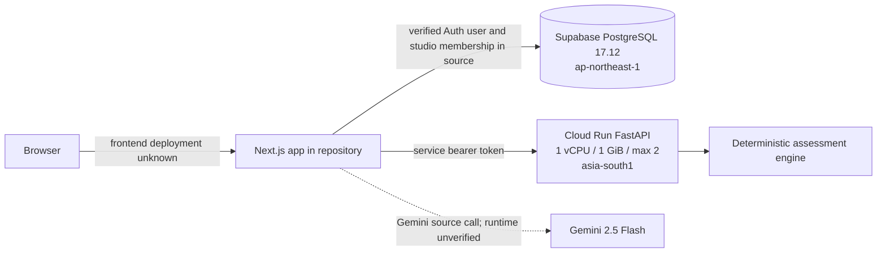

# Verified deployment architecture

## Inventory

| Component | State | Evidence |
|---|---|---|
| Next.js web application | Implemented in repository; deployed location and URL not verified | `apps/web/package.json`; no production URL found |
| FastAPI intelligence service | Implemented and deployed | Cloud Run service description; public health and OpenAPI requests returned 200 |
| Retention assessment route | Deployed in FastAPI OpenAPI; runtime not exercised | `POST /api/v1/retention/assess` requires service bearer token |
| Supabase PostgreSQL | Active and healthy | Authorized Supabase metadata; read-only count query returned scoped results |
| Supabase Auth / studio membership | Implemented in repository; production flow not independently verified | `getUser` and `StudioUser` membership checks in web server code |
| Gemini generation | Implemented in repository source; deployed status unverified | `gemini-2.5-flash` `generateContent` call in server-only recommendation code |
| Analytics output / Gemini results | Not benchmarked | No authenticated assessment or Gemini request was made |

## Runtime configuration observed

- Cloud Run project: `pranax-mvp`
- Service: `pranax-intelligence`
- Region: `asia-south1`
- URL: `https://pranax-intelligence-r3kbjl3dsq-el.a.run.app`
- Revision serving 100% traffic: `pranax-intelligence-00001-9bj`
- Per-instance allocation: 1 vCPU, 1 GiB memory
- Request concurrency: 80
- Request timeout: 300 seconds
- Maximum instances: 2
- Minimum instances: no explicit service setting found
- Startup CPU boost: enabled
- Public health route; service-token authorization on assessment route
- The service token is referenced through a Cloud Run secret reference; the secret value was not read.

## Data and trust boundaries

The repository's web server authenticates users through Supabase Auth and verifies studio membership in `StudioUser`. The web server constructs tenant scope for database access and sends an authenticated request to the intelligence service. The intelligence service itself does not access PostgreSQL and checks a shared bearer token. Runtime end-to-end tenant scope was not tested.

The active Supabase project is in `ap-northeast-1`, separate from Cloud Run's `asia-south1`. No latency claim between these regions was measured.

The repository's Gemini call is server-side code that includes computed retention metrics and the deterministic baseline recommendation in its prompt. The actual Next.js deployment and key configuration could not be established from the resources found.

## Diagram

## Security observation

Supabase inventory surfaced a critical advisory that `public._prisma_migrations` has RLS disabled. This audit made no change. The migration table's grants and access path require review by the database owner; enabling RLS without a reviewed policy can disrupt migration tooling.
