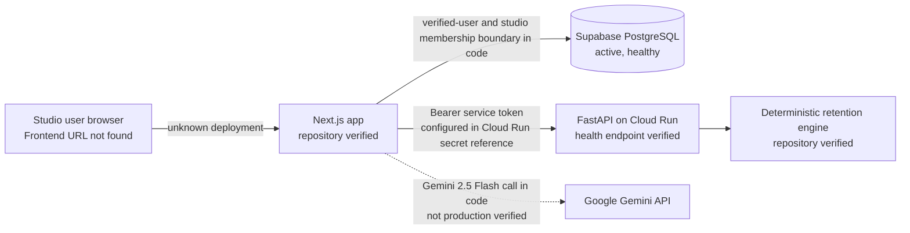

# Production Performance Report

## A. Executive summary

The active infrastructure is a single Google Cloud Run FastAPI intelligence service in `asia-south1` and a healthy Supabase PostgreSQL 17.12 project in `ap-northeast-1`. The Cloud Run health endpoint was available throughout the controlled probe. No production code, data, configuration, or deployment settings were changed.

The audit measured a 20-request serial probe of `GET /health`: 20/20 HTTP 200, 0% probe errors, 40-byte JSON response, mean end-to-end latency 162.96 ms, median 161.89 ms, p95 174.01 ms (nearest rank, exploratory at n=20), and max 179.26 ms. A p99 is not meaningful at this sample size. Probe throughput was approximately 3.8 requests/second for this paced, serial client and must not be interpreted as service throughput or capacity.

Cloud Monitoring showed 53 successful Cloud Run requests in the one-hour window, with approximately 6.36 ms weighted mean service request latency. This includes the audit probe and is not an independent user-traffic sample. Resource series showed about 1.02% mean CPU utilization and 6.99% mean memory utilization over the populated minute buckets. A single startup-latency point was 3.04 seconds. These sparse and low-load observations do not validate capacity.

The repository contains the Next.js app and deterministic analytics code, but a frontend deployment URL was not found. Authenticated assessment, member journeys, tenant isolation against two test accounts, and Gemini generation were not exercised. The 25/100/500 CCU targets are all **NOT VALIDATED**. No numeric infrastructure forecast is defensible without a production workload profile, database connection limits, and staged load results.

Readiness is **prototype infrastructure verified; product performance and scale unvalidated**. The Supabase dashboard inspection also returned a critical RLS-disabled advisory for `public._prisma_migrations`; no remediation was attempted.

## B. Infrastructure overview

| Component | Finding | Verification |
|---|---|---|
| Web app | Next.js 15.5.29 / React 19.1.1 in repository | Source and package metadata inspected; live URL and hosting platform unknown |
| Intelligence service | FastAPI, `pranax-intelligence` | Cloud Run service description and public health request |
| Cloud Run region | `asia-south1` | Cloud Run service metadata |
| CPU / memory | 1 vCPU / 1 GiB per instance | Cloud Run revision configuration |
| Concurrency / timeout | 80 requests / 300 seconds | Cloud Run configuration |
| Instance bounds | Max 2; minimum not explicitly set (default behavior) | Service annotations inspected |
| Supabase | PostgreSQL 17.12, `ap-northeast-1`, active and healthy | Supabase project metadata and read-only count query |
| Gemini | Model call exists in repository code; production integration not verified | Source inspection only; no API call |
| Frontend deployment | Unknown / inaccessible | No production URL or Vercel project configuration found |

The diagram's code paths do not establish that the frontend or Gemini integration is deployed. The Cloud Run service is configured with all ingress and exposes health publicly; the application assessment route separately requires a bearer token. Supabase tenant identity in the repository is resolved from verified Supabase Auth identity plus `StudioUser` membership. Production tenant isolation was not independently exercised.

## C. Frontend performance

No deployed frontend URL was identified. Lighthouse and browser journeys therefore could not be run against the live app. These values are **unavailable**, not zero:

| Metric | Result |
|---|---|
| LCP / FCP / INP / CLS | Not measured |
| TTFB / total page load | Not measured |
| JavaScript bundle transfer size | Not measured |
| Landing, dashboard, members, attendance, retention, auth journeys | Not tested |

The only browser screenshot captured is the public JSON health response, not a product page. See `evidence/health-endpoint.png`.

Chart: [Frontend performance metrics](evidence/charts/frontend-performance.svg).

## D. Backend performance

### Controlled HTTP probe

| Measure | Result |
|---|---:|
| Endpoint | `GET /health` |
| Environment | Live Cloud Run, `asia-south1`; serial audit runner |
| Probe period | 2026-11-20 20:11:47–20:11:52 UTC (2026-11-21 01:41:47–01:41:52 IST) |
| Requests / concurrency | 20 / 1 |
| Statuses / errors | 20 × 200 / 0 |
| Response payload | 40 bytes |
| Mean / median | 162.96 / 161.89 ms |
| p95 / p99 | 174.01 ms nearest-rank exploratory / not reported (n=20) |
| Min / max | 149.81 / 179.26 ms |
| Probe throughput | Approximately 3.8 requests/s, serial and paced |

These end-to-end times include network, TLS, and client overhead. They measure the tiny health handler, not the analytics route. The p95 is a small-sample order statistic rather than a stable service percentile. The throughput is a property of this probe schedule, not a saturation result.

Chart: [API probe latency](evidence/charts/api-latency.svg).

### Cloud Monitoring

Observation window: **2026-11-20 19:11:52–20:11:52 UTC** (2026-11-21 00:41:52–01:41:52 IST).

Cloud Run exposed 53 successful requests in the window; no 401 or 422 request counts were present and no 5xx series appeared. Requests from this audit are included, so the request count is not an availability SLI. The weighted mean server request latency was approximately 6.36 ms across those 53 requests. No reliable p95/p99 could be derived from the available sample. CPU and memory metrics are minute-bucket distributions with sparse points; reported means are 1.02% and 6.99%. Peak observed instance count was one. One startup-latency sample was 3,037.6 ms.

The Cloud Run request-latency metric and the audit runner's end-to-end latency measure different intervals and are not contradictory. Monitoring resource consumption was low during this quiet observation window; it does not establish headroom under load.

Chart: [Cloud Run resource utilization](evidence/charts/resource-utilization.svg).

## E. Intelligence engine performance

The deployed service exposes `POST /api/v1/retention/assess`, protected by a service bearer token. It was **not called** because the request is not proven side-effect-free end-to-end and no authorized benchmark member/token was provided. Processing time, output generation time, memory during assessment, and excluded-record counts are unavailable.

The current checked-in synthetic v1.3.0 dataset and the database were verified by count only:

| Dimension | Count / range |
|---|---:|
| Members | 350 |
| Membership periods | 1,318 |
| Attendance records | 20,882 |
| Attendance date range | 2025-09-30 to 2026-11-20 |
| Membership start range | 2025-09-23 to 2026-11-19 |
| Records excluded in a benchmark | Not measured; no assessment run |

Chart: [Retention processing time](evidence/charts/processing-time.svg).

The database's scoped synthetic studio counts matched the manifest. The database also has 234 retention snapshots, while the checked-in source dataset manifest has zero; their contents were not read or used as benchmark outputs. The manifest explicitly says its retention outputs are not operational results.

Analytical correctness and performance are distinct. The local deterministic intelligence suite passed 85 tests. That establishes code-level test results only; it does not independently validate the deployed revision, production tenant isolation, or real-world predictive quality. Scores are prioritization heuristics, not churn probabilities.

## F. Gemini AI performance

Repository inspection found a server-side call to `gemini-2.5-flash:generateContent`, with analytical metrics included in the prompt and `responseMimeType: application/json`. The local implementation uses a 5-second timeout and falls back to deterministic copy on missing key, non-2xx response, malformed output, or exception. JSON is parsed and required fields are checked for truthiness, but there is no dedicated runtime schema validator for Gemini output.

These are source-code findings, not verified production behavior. The only active Cloud Run service is the intelligence service and its environment contains a secret reference for the inter-service token; this audit did not establish a deployed Next.js runtime or Gemini key/configuration. No Gemini requests were sent. Model latency, end-to-end generation latency, token use, success rate, validation rate, error rate, and quota/rate limits are **unavailable**.

Chart: [Gemini response latency](evidence/charts/gemini-latency.svg).

## G. Scalability assessment

| Target | Status | Evidence / constraint |
|---|---|---|
| 25 concurrent users | **NOT VALIDATED** | No authenticated journey or representative workload profile; only a serial health probe |
| 100 concurrent users | **NOT VALIDATED** | Same; Cloud Run max 2 instances and database connection limits are not known |
| 500 concurrent users | **NOT VALIDATED** | Same; no basis for sizing database, service, or Gemini quotas |

Current configuration is 1 vCPU and 1 GiB per instance, concurrency 80, maximum 2 instances. This describes configuration only. It does not imply 160 active users or any CCU capability. A numeric per-tier capacity estimate cannot be derived from health-handler latency or one quiet monitoring hour. Workload mix, requests per user, think time, tenant count, database connection/pool caps, and error budgets are missing.

The defensible infrastructure estimate for all three tiers is therefore **TBD pending representative staging load tests**. Use a separately isolated staging deployment with synthetic tenants, matching database tier/connection configuration, and mocked or tightly budgeted Gemini calls. Preserve production's current settings during this audit.

## H. Reliability and security

- **Observed availability:** 20/20 health probes returned 200 in a 5.3-second interval. Cloud Monitoring showed 53 successful requests in its one-hour window. This is not a long-duration availability SLI.
- **Errors:** no errors in the audit health probe; no 401/422/5xx counts observed in the monitoring window. The analytics operation was not exercised.
- **Authentication:** source code verifies Supabase users and studio membership in the Next.js boundary. The intelligence endpoint checks a bearer service token. Login/signup and session behavior were not tested against production.
- **Tenant isolation:** not independently tested; no dedicated test accounts or frontend deployment URL were available. Do not treat source inspection as runtime validation.
- **Supabase RLS:** connected project metadata reports healthy, but the inspection tool returned a critical advisory that RLS is disabled on `public._prisma_migrations`. This table is the only table reported without RLS. No policy or permission remediation was applied. Verify grants and decide a safe policy with the database owner before exposing the project to real tenant use.
- **Gemini response validity:** source-level checks exist but are not a full schema validation; production behavior was not tested.

## I. Bottlenecks and recommendations

The primary limitation in this audit is observability and missing safe staging access, rather than a demonstrated saturated component. The single-service maximum of two instances and unknown database connection cap are constraints to resolve before scale claims. Current metrics were recorded under low request volume and cannot locate a load bottleneck.

See [recommendations.md](recommendations.md) for sequenced actions. Immediate items are to resolve the RLS finding through an owner-reviewed change, identify the frontend deployment URL, create an isolated staging environment, and add approved test accounts plus telemetry for route-level latency and analytics/Gemini timings. Do not enable production load testing to obtain these missing numbers.

## J. Methodology and evidence

- **Public endpoint:** 20 sequential `GET /health` requests, one at a time, with 100 ms pacing. No writes and no authorization bypass.
- **API discovery:** public FastAPI `/openapi.json` read; only endpoint paths and methods recorded.
- **Cloud Run:** read-only `gcloud run services list/describe`; no settings changed.
- **Monitoring:** read-only Cloud Monitoring API query for six Cloud Run metrics over the stated one-hour UTC window.
- **Supabase:** connected project metadata, public table inventory, and one count-only query scoped to the known synthetic studio ID. No names, emails, phones, or member rows returned.
- **Dataset:** local v1.3.0 manifest and record counts; date ranges computed locally. No generated recommendation content was included.
- **Correctness checks:** existing local intelligence tests only; no production test requests.
- **Browser:** Chrome headless screenshot of the public JSON health endpoint. No frontend Lighthouse run was possible.
- **Artifacts:** sanitized details and exact probe values are in `evidence/`; charts identify environment and period. Unavailable metrics are explicitly labeled.

All UTC timestamps are retained in the machine-readable results. Since the local timezone is Asia/Kolkata, the observation period was on 21 November 2026 local time.
